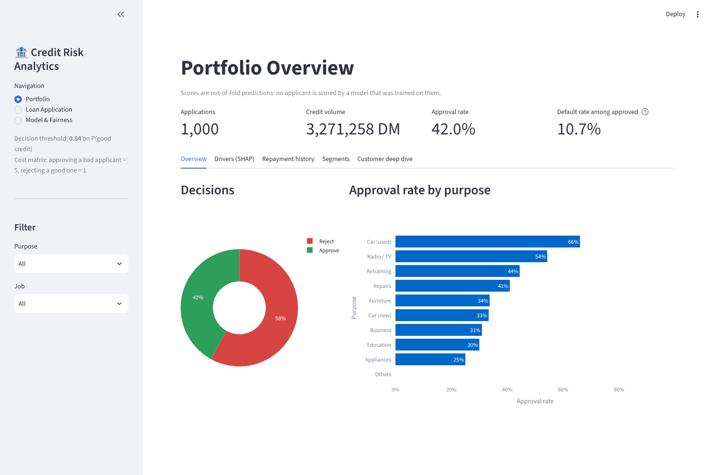
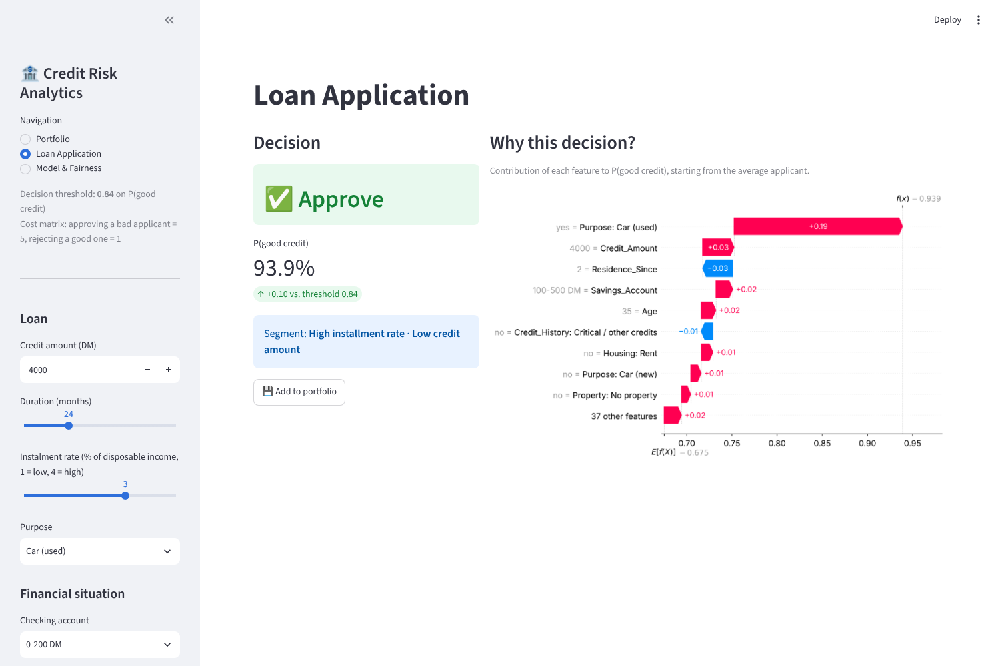
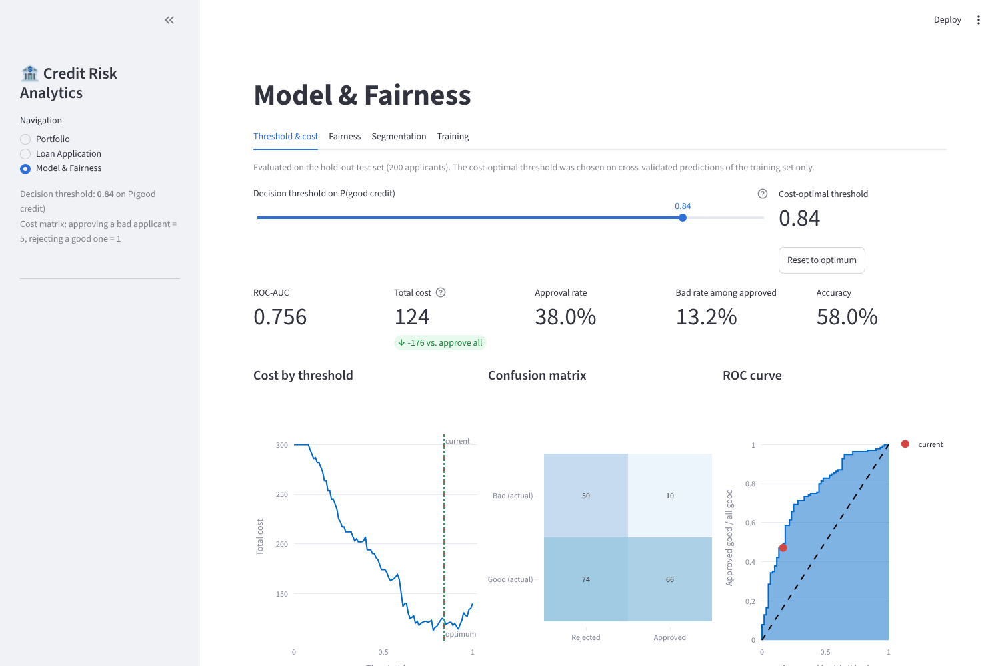
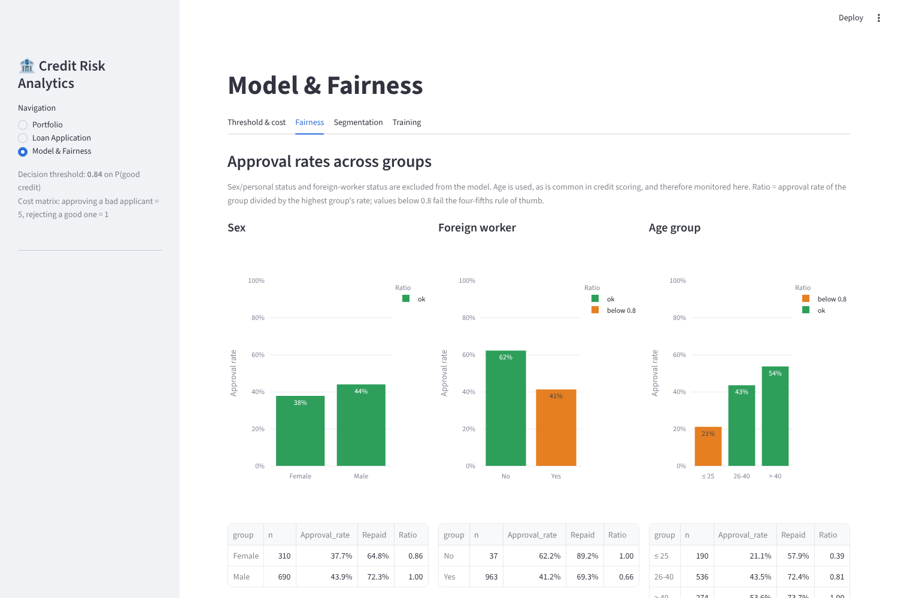
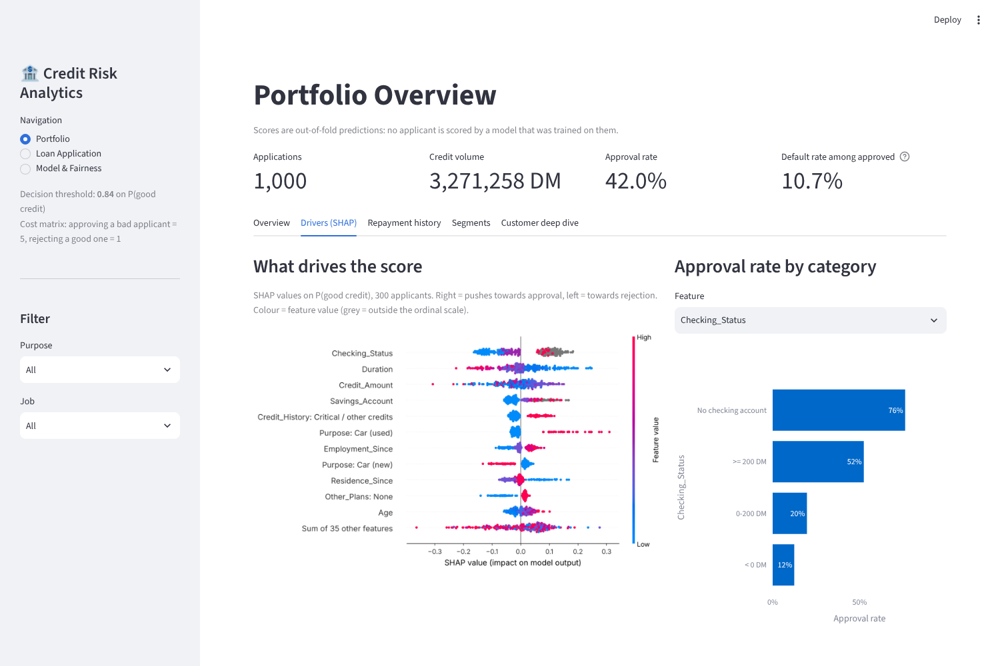

# Credit Risk Analytics Dashboard

[](https://github.com/<your-username>/credit-risk-dashboard/actions/workflows/ci.yml)

Explainable, cost-sensitive credit scoring for the **UCI Statlog (German Credit Data)** dataset, built as an interactive **Streamlit** dashboard for loan officers and risk managers.

The goal is not the highest possible accuracy but a **decision the bank can defend**:

- approve or reject based on the **expected cost** of a wrong decision,
- **explain** every individual decision with SHAP,
- keep the model consistent with **domain logic**,
- and **monitor fairness** across applicant groups.



## Key results

Evaluated with nested, stratified 5-fold cross-validation, repeated 3 times (see [`reports/model_comparison.md`](reports/model_comparison.md)):

| | ROC-AUC | Cost per application | Approval rate | Bad rate among approved |
|---|---|---|---|---|
| Approve everyone (no model) | – | 1.50 | 100 % | 30.0 % |
| Logistic regression (baseline) | 0.781 | 0.55 | 34 % | 8.3 % |
| **XGBoost, dashboard default** | **0.796** | **0.56** | **38 %** | **10.4 %** |

- Compared with approving every applicant, the model cuts the expected misclassification cost by **about 63 %**. The bad rate among approved loans falls from 30 % to about 10 %.
- XGBoost ranks applicants better than the logistic-regression baseline (higher AUC) and approves more of them. Its expected cost is within the variation between folds.
- Excluding protected attributes and adding monotone constraints cost no measurable predictive performance.

## Features

| Page | What it does |
|---|---|
| **Portfolio** | KPIs, approval rates by purpose and category, global SHAP drivers, historical repayment rates, k-means customer segments (PCA view) and a deep dive into any applicant with a local SHAP waterfall. All scores are **out-of-fold**, so no applicant is scored by a model trained on them. |
| **Loan Application** | Enter a new application (all 20 attributes) and get an approve/reject decision, P(good credit) relative to the threshold, the assigned segment and a SHAP explanation. Cases can be added to the portfolio. |
| **Model & Fairness** | Move the decision threshold and see cost, approval rate, bad rate, confusion matrix and ROC curve update live. Compare approval rates across sex, nationality and age (four-fifths rule). Configure the segmentation and retrain the model with other hyperparameters or with protected attributes switched on. |

| Loan application | Threshold & cost |
|---|---|
|  |  |

## Design decisions

**Cost-sensitive threshold instead of 50 %.** The dataset documentation defines a cost matrix in which approving a bad applicant costs 5 and rejecting a good one costs 1. The threshold on P(good credit) is chosen to minimise this cost. It is tuned on cross-validated predictions of the training data and then applied unchanged to the test set. The result (≈ 0.84) matches the theoretical optimum for calibrated probabilities, 5 / (5 + 1) ≈ 0.83.

**Monotone constraints only where the order is unambiguous.** For checking balance, savings and employment duration, a higher value may never lower the predicted creditworthiness. This is enforced through XGBoost monotone constraints and verified in the tests. Categories that are not points on the scale ("no checking account", "unknown savings") are encoded as separate indicators. Forcing them onto the scale would contradict the data: applicants without a checking account repay most often (88 %). Credit history is deliberately left unconstrained. In this dataset, "critical account / other credits" repays *more* often (83 %) than "no credits taken" (38 %), so any imposed order would be arbitrary.

**Protected attributes excluded by default.** Personal status/sex and foreign-worker status are not used by the model, but they are still monitored on the fairness tab. Excluding them does not remove their proxies. Age, for example, is correlated with personal status, and applicants aged 25 or younger are approved far less often. The tab makes such gaps visible instead of hiding them.



**Explanations in business terms.** SHAP values are computed on the probability scale and shown with the original category labels (e.g. `< 100 DM = Savings_Account`). Tree models need no feature scaling, so amounts and durations appear in their real units.



## Getting started

Requires Python 3.11 or newer.

```bash
git clone https://github.com/<your-username>/credit-risk-dashboard.git
cd credit-risk-dashboard

python -m venv .venv
# Windows: .venv\Scripts\activate
# macOS/Linux: source .venv/bin/activate

pip install -r requirements.txt
streamlit run dashboard.py
```

The dashboard opens at `http://localhost:8501`. The model trains on start-up in a few seconds and is cached afterwards.

Development:

```bash
pip install -r requirements-dev.txt
pytest                             # data, model, monotonicity and app smoke tests
ruff check .
python scripts/evaluate_model.py   # regenerates reports/model_comparison.md (~1 min)
```

## Repository structure

```
├── dashboard.py                 # Streamlit app (UI only)
├── credit_risk/
│   ├── data.py                  # loading, recoding, feature groups
│   ├── model.py                 # pipeline, cost matrix, threshold selection, evaluation
│   ├── explain.py               # SHAP explanations with readable values
│   └── segmentation.py          # k-means segments, PCA projection, automatic naming
├── tests/                       # pytest suite (runs in GitHub Actions)
├── scripts/evaluate_model.py    # nested cross-validation model comparison
├── reports/model_comparison.md  # output of the script above
├── notebooks/                   # exploratory analysis (course work)
├── data/german.data             # raw dataset, 1,000 applications
└── assets/                      # screenshots
```

The notebooks document the exploratory phase of the project: data recoding, a first random-forest model, clustering and SHAP. They download the data via `ucimlrepo` (`pip install -r requirements-dev.txt`). The dashboard and its package are the consolidated, tested version.

## Limitations

- 1,000 applications from 1990s Germany: the project shows the method, not a production scorecard. With 200 test applicants, single hold-out figures vary by several points, so the cross-validated results above are the more reliable ones.
- The cost matrix is taken from the dataset documentation, not from a real bank's loss data.
- The fairness check is descriptive. It shows approval-rate gaps but does not correct them, and it would not replace a legal assessment under anti-discrimination law.

## Data source

Hofmann, H. (1994). *Statlog (German Credit Data)* [Dataset]. UCI Machine Learning Repository. https://doi.org/10.24432/C5NC77 — licensed under CC BY 4.0.

## Context

Developed as part of a Master's course project at the University of Passau.
